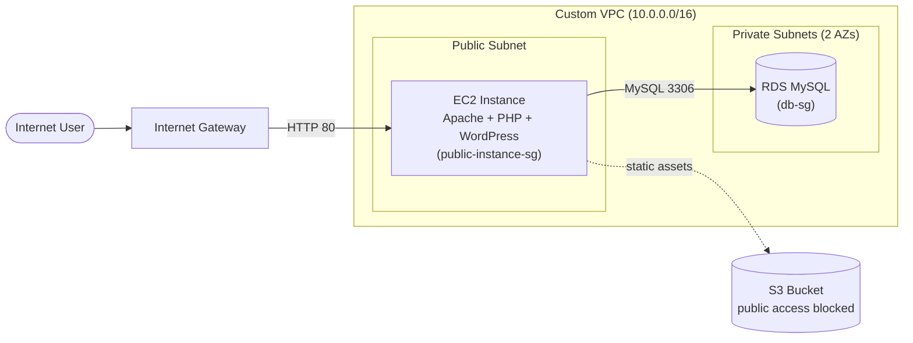

# WordPress Hosting on AWS: Custom VPC, EC2, RDS & S3

A hands-on cloud infrastructure project that hosts a WordPress website on AWS using a custom, network-isolated architecture. The web server runs on **EC2 in a public subnet**, the database runs on **RDS MySQL in a private subnet**, and an **S3 bucket** is provisioned for static assets.


---

## Table of Contents

- [Overview](#overview)
- [Architecture](#architecture)
- [Tech Stack](#tech-stack)
- [Prerequisites](#prerequisites)
- [Implementation Steps](#implementation-steps)
  - [1. Create the VPC](#1-create-the-vpc)
  - [2. Create the Public Subnet and Internet Gateway](#2-create-the-public-subnet-and-internet-gateway)
  - [3. Create the Private Subnets](#3-create-the-private-subnets)
  - [4. Launch the EC2 Instance](#4-launch-the-ec2-instance)
  - [5. Create the RDS MySQL Database](#5-create-the-rds-mysql-database)
  - [6. Configure Security Groups](#6-configure-security-groups)
  - [7. Create the S3 Bucket](#7-create-the-s3-bucket)
  - [8. Install and Configure WordPress](#8-install-and-configure-wordpress)
- [Verification](#verification)
- [Security Considerations](#security-considerations)
- [Troubleshooting](#troubleshooting)
- [Cleanup](#cleanup)
- [Key Learnings](#key-learnings)
- [Possible Improvements](#possible-improvements)
- [Author](#author)

---

## Overview

This project builds a two-tier WordPress deployment from the ground up inside a **custom VPC** rather than the default one. It demonstrates core AWS networking and compute concepts:

- Designing a VPC with a custom CIDR block, public and private subnets, and separate route tables
- Exposing only the web tier to the internet while keeping the database fully private
- Controlling traffic between tiers with security groups
- Connecting an EC2-hosted application to a managed RDS database
- Provisioning a private S3 bucket for static assets

## Architecture



| Layer | Service | Placement | Purpose |
|-------|---------|-----------|---------|
| Network | VPC | Custom CIDR | Isolated virtual network |
| Web tier | EC2 (Apache + PHP + WordPress) | Public subnet | Serves the website |
| Database tier | RDS MySQL | Private subnets (no public access) | Stores WordPress data |
| Storage | S3 | Regional | Static asset storage (public access blocked) |
| Routing | Internet Gateway + route tables | VPC | Internet access for the public subnet only |

**Traffic flow:** Internet → Internet Gateway → EC2 (public subnet) → RDS MySQL (private subnet, port 3306 from the EC2 security group only).

## Tech Stack

- **Cloud:** AWS (VPC, EC2, RDS, S3, IAM, Security Groups)
- **OS:** Amazon Linux 2
- **Web server:** Apache HTTP Server
- **Runtime:** PHP 8.0 (PHP-FPM)
- **Database:** MySQL on Amazon RDS (MariaDB client on EC2)
- **Application:** WordPress

## Prerequisites

- An AWS account with permissions to create VPCs, EC2 instances, RDS databases, S3 buckets, and security groups
- An EC2 key pair (`.pem`) for SSH access
- A terminal (or PuTTY on Windows) with an SSH client
- Basic familiarity with the AWS Management Console and the Linux command line

---

## Implementation Steps

> Replace the example values (CIDR ranges, names, passwords) with your own.

### 1. Create the VPC

1. Open the **VPC** console and choose **Create VPC**.
2. Select **VPC only**.
3. Enter a name and an IPv4 CIDR block (for example, `10.0.0.0/16`).
4. Create the VPC. AWS automatically creates a **main route table** that contains only the `local` route.

### 2. Create the Public Subnet and Internet Gateway

**Public subnet**

1. Go to **Subnets → Create subnet** and select your custom VPC.
2. Name it (for example, `public-subnet-1`), choose an Availability Zone, and assign a CIDR block (for example, `10.0.1.0/24`).
3. Enable **Auto-assign public IPv4 address** on the subnet so instances launched in it receive a public IP.

**Internet Gateway**

1. Go to **Internet gateways → Create internet gateway** and give it a name.
2. **Attach** the gateway to your custom VPC.

**Route table**

1. Open the route table associated with the public subnet and choose **Edit routes**.
2. Add a route: destination `0.0.0.0/0`, target = your Internet Gateway.

### 3. Create the Private Subnets

1. Create private subnets in the same VPC (for example, `10.0.2.0/24` and `10.0.3.0/24`), **in two different Availability Zones**. RDS requires a subnet group that spans at least two AZs.
2. Leave **Auto-assign public IP** disabled.
3. Create a separate route table that contains only the `local` route and associate it with the private subnets.

The **Resource map** in the VPC console should confirm that the public subnet routes to the Internet Gateway while the private subnets do not.

### 4. Launch the EC2 Instance

1. Open **EC2 → Launch instance**.
2. Choose **Amazon Linux 2** and an instance type (for example, `t2.micro`).
3. Select or create a key pair.
4. Under **Network settings**, choose your custom VPC and the **public subnet**.
5. Create a security group (for example, `public-instance-sg`) allowing:
   - SSH (22) from **your IP**
   - HTTP (80) from the internet (or from your IP while testing)
6. Launch the instance.

### 5. Create the RDS MySQL Database

1. **Create a DB subnet group** that contains **only the private subnets**.
2. Go to **RDS → Create database** and select **Standard create**.
3. Choose the **MySQL** engine and a version, and select the **Free tier** template.
4. Set the DB instance identifier, master username, and master password.
5. Choose a DB instance class and storage type/size.
6. Under **Connectivity**, select your custom VPC and the private DB subnet group, and set **Public access = No**.
7. Attach a dedicated security group (for example, `db-sg`).
8. Set authentication to **Password authentication** and create the database.

### 6. Configure Security Groups

Traffic between the tiers is restricted with security-group references instead of IP addresses.

| Security Group | Rule Type | Port | Source |
|----------------|-----------|------|--------|
| `public-instance-sg` | SSH | 22 | Your IP |
| `public-instance-sg` | HTTP | 80 | Your IP / `0.0.0.0/0` |
| `db-sg` | MySQL/Aurora | 3306 | `public-instance-sg` |

Remove any default or broader inbound rules from `db-sg` so that the database accepts connections **only from the web server**.

### 7. Create the S3 Bucket

1. Open **S3 → Create bucket** and enter a globally unique name (for example, `wordpress-assets-<unique-suffix>`).
2. Keep **Block all public access** enabled.
3. Create the bucket.

### 8. Install and Configure WordPress

Connect to the instance over SSH:

```bash
chmod 400 your-key.pem
ssh -i your-key.pem ec2-user@<EC2_PUBLIC_IP>
```

**Install the LAMP components**

```bash
sudo yum update -y
sudo yum install httpd -y
sudo yum install mariadb-server -y          # provides the MySQL client
sudo amazon-linux-extras install php8.0 -y

sudo systemctl enable --now httpd
sudo systemctl enable --now php-fpm
```

**Create the WordPress database on RDS**

```bash
mysql -h <RDS_ENDPOINT> -u <MASTER_USERNAME> -p
```

```sql
CREATE DATABASE wordpress;
CREATE USER 'wordpress'@'%' IDENTIFIED BY '<STRONG_PASSWORD>';
GRANT ALL PRIVILEGES ON wordpress.* TO 'wordpress'@'%';
FLUSH PRIVILEGES;
EXIT;
```

**Download WordPress**

```bash
cd /var/www/html
sudo wget https://wordpress.org/latest.tar.gz
sudo tar -xzf latest.tar.gz
sudo cp -r wordpress/* .
sudo rm -rf wordpress latest.tar.gz
sudo cp wp-config-sample.php wp-config.php
```

**Configure the database connection**

```bash
sudo nano wp-config.php
```

```php
define( 'DB_NAME',     'wordpress' );
define( 'DB_USER',     'wordpress' );
define( 'DB_PASSWORD', '<STRONG_PASSWORD>' );
define( 'DB_HOST',     '<RDS_ENDPOINT>' );
```

**Set permissions and restart services**

```bash
sudo chown -R apache:apache /var/www/html
sudo systemctl restart httpd php-fpm
```

**Finish the installation**

Open `http://<EC2_PUBLIC_DNS>` in your browser, complete the WordPress setup form (site title, admin username, password, email), and log in to the dashboard.

---

## Verification

- [ ] EC2 instance is reachable over SSH from your IP
- [ ] EC2 can connect to RDS on port 3306
- [ ] RDS is **not** reachable from the public internet
- [ ] WordPress setup page loads at the EC2 public DNS
- [ ] Admin dashboard and the public site load successfully
- [ ] S3 bucket exists with **Block all public access** enabled

## Security Considerations

- **Network isolation:** The database lives in private subnets with no route to the Internet Gateway and **Public access = No**.
- **Least privilege:** The DB security group accepts MySQL traffic only from the web server's security group.
- **Restricted admin access:** SSH is limited to a single trusted IP address.
- **Private storage:** The S3 bucket blocks all public access.
- **Credentials:** Use strong, unique passwords and never commit `wp-config.php` or secrets to the repository.

## Troubleshooting

| Issue | Likely Cause | Fix |
|-------|--------------|-----|
| "Error establishing a database connection" | Wrong endpoint/credentials or blocked port | Verify `wp-config.php` values and that `db-sg` allows 3306 from `public-instance-sg` |
| Site not loading in the browser | Missing route or security-group rule | Confirm the `0.0.0.0/0` → IGW route and the HTTP (80) inbound rule |
| Cannot create the RDS subnet group | Subnets are in a single AZ | Create private subnets in at least two Availability Zones |
| Cannot SSH into the instance | Wrong key permissions or IP changed | Run `chmod 400` on the key and update the SSH rule with your current IP |

## Cleanup

To avoid unnecessary charges, delete the resources when finished, in this order:

1. RDS database (and its DB subnet group)
2. EC2 instance
3. S3 bucket (empty it first)
4. Internet Gateway (detach, then delete)
5. Subnets and route tables
6. VPC

## Key Learnings

- How a VPC, subnets, route tables, and an Internet Gateway work together
- The practical difference between public and private subnets
- Using security-group references to enforce tier-to-tier access
- Connecting a self-managed web server to a managed database service
- Why RDS subnet groups must span multiple Availability Zones

## Possible Improvements

- Add a **NAT Gateway** so private resources can reach the internet for updates
- Place the instance behind an **Application Load Balancer** with an **Auto Scaling Group**
- Enable **RDS Multi-AZ** for high availability
- Attach an **IAM role** to EC2 and offload WordPress media to S3
- Add **HTTPS** with ACM and a custom domain in Route 53
- Codify the whole setup with **Terraform** or **CloudFormation**

## Author

**Muhammad Tayyab**
DevOps Engineer | Lahore, Pakistan

[](https://www.linkedin.com/in/muhammad-tayyab-0bab48264)
[](https://github.com/<your-username>)

---

If you found this project helpful, consider giving it a ⭐
